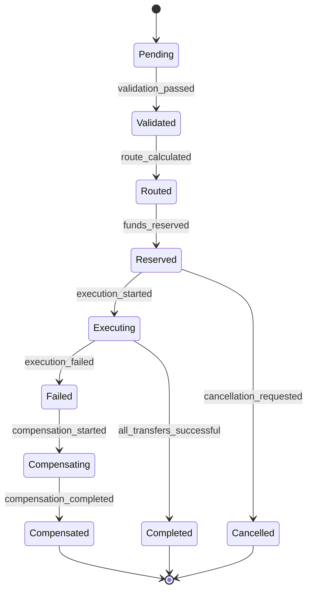

# Трансферное ядро (Transfer Core)

*← Назад к [[README]]*

#архитектура #трансфер

**Трансферное ядро** — это универсальный слой системы, который получает цепочки трансферов от функциональных уровней ([[High_Level_Design#Предлагаемое разделение на 3 уровня|Payment Gateway, Corporate Transfer Hub, Financial Orchestration Platform]]) и обеспечивает их выполнение через специализированные адаптеры провайдеров.

## Архитектурная позиция

```
┌─────────────────────────────────────────────────────────┐
│              Функциональные уровни                       │
├─────────────────┬─────────────────┬─────────────────────┤
│ Payment Gateway │ Corporate Hub   │ Orchestration       │
│                 │                 │ Platform           │
└─────────────────┴─────────────────┴─────────────────────┘
                           │
                    Цепочки трансферов
                           │
                           ▼
┌─────────────────────────────────────────────────────────┐
│                ТРАНСФЕРНОЕ ЯДРО                         │
│  ┌─────────────┐ ┌─────────────┐ ┌─────────────────┐   │
│  │   Routing   │ │ Execution   │ │   State         │   │
│  │   Engine    │ │   Engine    │ │   Management    │   │
│  └─────────────┘ └─────────────┘ └─────────────────┘   │
└─────────────────────────────────────────────────────────┘
                           │
                    Унифицированные команды
                           │
                           ▼
┌─────────────────────────────────────────────────────────┐
│                  Адаптеры провайдеров                    │
├─────────────────┬─────────────────┬─────────────────────┤
│ Banking         │ Crypto          │ Payment             │
│ Adapters        │ Adapters        │ System Adapters     │
└─────────────────┴─────────────────┴─────────────────────┘
```

## Основные компоненты

### 1. Transfer Chain Processor

**Назначение:** Обработка входящих цепочек трансферов от функциональных уровней.

**Ответственности:**
- Валидация целостности цепочки трансферов
- Декомпозиция сложных операций на атомарные трансферы
- Определение зависимостей между трансферами
- Создание плана исполнения (execution plan)

```json
{
  "chain_id": "chain_12345",
  "source_level": "corporate_hub",
  "transfers": [
    {
      "transfer_id": "tf_001",
      "type": "debit",
      "from_participant": "company_a",
      "to_account": "escrow_001",
      "asset": {"type": "USD", "amount": "10000.00"},
      "dependencies": []
    },
    {
      "transfer_id": "tf_002",
      "type": "conditional_credit",
      "from_account": "escrow_001",
      "to_participant": "supplier_b",
      "asset": {"type": "USD", "amount": "8500.00"},
      "dependencies": ["tf_001"],
      "conditions": ["delivery_confirmed"]
    }
  ]
}
```

### 2. Routing Engine

**Назначение:** Интеллектуальная маршрутизация трансферов через оптимальные каналы провайдеров.

**Компоненты:**

#### Route Calculator
- Анализ доступных каналов для заданной пары участников и типа актива
- Расчет стоимости, времени и надежности каждого маршрута
- Учет лимитов провайдеров и участников
- Поддержка multi-hop маршрутизации

#### Channel Selector
```typescript
interface ChannelSelection {
  primary_route: {
    channel_id: string;
    provider_id: string;
    estimated_cost: Money;
    estimated_time: Duration;
    reliability_score: number;
  };
  fallback_routes: ChannelSelection[];
  routing_strategy: "cost_optimal" | "time_optimal" | "reliability_optimal" | "balanced";
}
```

#### Load Balancer
- Распределение нагрузки между провайдерами
- Мониторинг доступности каналов в реальном времени
- Динамическое переключение при сбоях

### 3. Execution Engine

**Назначение:** Координация выполнения трансферов с обеспечением ACID-свойств.

**Модули:**

#### Transaction Coordinator
- Управление двухфазными коммитами (2PC)
- Обработка компенсирующих транзакций (Saga pattern)
- Координация между множественными провайдерами

#### Execution Strategies:

**Synchronous Execution:**
```
1. Reserve funds (Phase 1)
2. Execute transfers atomically
3. Commit or rollback all operations
```

**Asynchronous Execution (Saga):**
```
1. Execute step 1 → Success → Execute step 2
2. Execute step 2 → Failure → Compensate step 1
3. Continue until completion or full compensation
```

**Parallel Execution:**
```
1. Independent transfers executed concurrently
2. Dependent transfers wait for prerequisites
3. Final reconciliation and confirmation
```

### 4. State Management System

**Назначение:** Отслеживание состояния всех трансферов и обеспечение консистентности.

#### Transfer State Machine


#### Event Sourcing
- Все изменения состояния записываются как события
- Возможность восстановления состояния из журнала событий
- Аудитный след всех операций

#### State Storage
```json
{
  "transfer_id": "tf_001",
  "chain_id": "chain_12345",
  "current_state": "executing",
  "state_history": [
    {"state": "pending", "timestamp": "2024-01-01T10:00:00Z"},
    {"state": "validated", "timestamp": "2024-01-01T10:00:05Z"},
    {"state": "routed", "timestamp": "2024-01-01T10:00:10Z"}
  ],
  "execution_context": {
    "selected_channel": "bank_transfer_swift",
    "provider_transaction_id": "swift_12345",
    "reserved_amount": "10000.00"
  }
}
```

### 5. Provider Adapter Framework

**Назначение:** Унификация взаимодействия с различными типами провайдеров.

#### Базовый интерфейс адаптера
```typescript
interface ProviderAdapter {
  // Управление соединением
  connect(): Promise<ConnectionStatus>;
  disconnect(): Promise<void>;
  healthCheck(): Promise<HealthStatus>;

  // Операции с трансферами
  initiateTransfer(request: TransferRequest): Promise<TransferResponse>;
  queryTransferStatus(transferId: string): Promise<TransferStatus>;
  cancelTransfer(transferId: string): Promise<CancelResponse>;

  // Управление балансами и лимитами
  getBalance(accountId: string, assetType: string): Promise<Balance>;
  getLimits(participantId: string): Promise<Limits>;

  // Webhook обработка
  processWebhook(payload: WebhookPayload): Promise<ProcessingResult>;
}
```

#### Специализированные адаптеры

**Banking Adapter:**
- SWIFT интеграции
- Локальные банковские системы
- Open Banking APIs
- Соответствие PSD2/PCI DSS

**Crypto Adapter:**
- Blockchain networks (Bitcoin, Ethereum, etc.)
- Centralized exchanges APIs
- DeFi protocols
- Multi-signature wallet management

**Payment System Adapter:**
- Card processing networks
- Digital wallets (Apple Pay, Google Pay)
- Alternative payment methods
- Buy-now-pay-later providers

### 6. Monitoring & Observability

#### Metrics Collection
- Transfer throughput и latency
- Success/failure rates по провайдерам
- Cost analysis и fee optimization
- Channel availability мониторинг

#### Alerting System
- Real-time notifications о сбоях
- Threshold-based alerts для лимитов
- Anomaly detection для подозрительных операций
- Integration со внешними incident management системами

#### Distributed Tracing
- End-to-end трассировка цепочек трансферов
- Performance bottleneck identification
- Cross-service dependency mapping

## Ключевые паттерны и принципы

### 1. Идемпотентность
Все операции ядра должны быть идемпотентными:
```typescript
interface TransferOperation {
  idempotency_key: string; // Уникальный ключ для предотвращения дублирования
  operation_id: string;    // Внутренний идентификатор операции
}
```

### 2. Circuit Breaker Pattern
Защита от каскадных сбоев при недоступности провайдеров:
```typescript
interface CircuitBreakerConfig {
  failure_threshold: number;     // Количество сбоев для открытия circuit
  recovery_timeout: Duration;    // Время ожидания перед попыткой восстановления
  half_open_max_calls: number;   // Количество тестовых вызовов в half-open состоянии
}
```

### 3. Retry with Exponential Backoff
Обработка временных сбоев с интеллектуальными повторными попытками:
```typescript
interface RetryConfig {
  max_attempts: number;
  initial_delay: Duration;
  max_delay: Duration;
  backoff_multiplier: number;
  jitter: boolean; // Добавление случайности для предотвращения thundering herd
}
```

### 4. Graceful Degradation
Система должна продолжать работать даже при частичных сбоях:
- Автоматическое переключение на резервные каналы
- Откладывание некритичных операций
- Уведомление пользователей о снижении качества сервиса

## API Интерфейсы

### Входящий API (от функциональных уровней)

```http
POST /api/v1/transfer-chains
Content-Type: application/json

{
  "chain_id": "chain_12345",
  "source_level": "corporate_hub",
  "priority": "normal",
  "execution_mode": "async_saga",
  "transfers": [...],
  "completion_webhook": "https://corporate-hub/webhooks/completion"
}
```

### Исходящий API (к адаптерам провайдеров)

```http
POST /api/v1/adapters/{provider_id}/transfers
Content-Type: application/json

{
  "transfer_id": "tf_001",
  "idempotency_key": "idem_12345",
  "from_account": {...},
  "to_account": {...},
  "asset": {...},
  "execution_context": {...}
}
```

## Масштабирование и производительность

### Горизонтальное масштабирование
- **Stateless компоненты:** Routing Engine, Transfer Chain Processor
- **Stateful компоненты:** State Management с sharding по chain_id/transfer_id
- **Database sharding:** Разделение по участникам или временным интервалам

### Кэширование
- **Route cache:** Кэширование оптимальных маршрутов для частых пар участников
- **Provider capability cache:** Кэширование возможностей и лимитов провайдеров
- **Exchange rate cache:** Кэширование курсов валют для cost calculation

### Асинхронная обработка
- **Message queues:** Для обработки долгих операций
- **Event-driven architecture:** Реакция на изменения состояний
- **Batch processing:** Группировка мелких трансферов для оптимизации

## Безопасность

### Аутентификация и авторизация
- **mTLS** для связи между компонентами
- **JWT tokens** с коротким сроком жизни
- **RBAC** для доступа к различным операциям

### Шифрование
- **Encryption at rest:** Все персональные данные и финансовая информация
- **Encryption in transit:** Все API calls и webhook notifications
- **Key rotation:** Регулярная ротация ключей шифрования

### Audit Trail
- **Immutable log** всех операций
- **Digital signatures** критичных транзакций
- **Compliance reporting** для регуляторных требований

---

## Связанные концепции

- **[[High_Level_Design]]** — функциональные уровни над ядром
- **[[Transaction_Lifecycle]]** — как ядро управляет жизненным циклом
- **[[Transfer]]** — базовая операция, обрабатываемая ядром
- **[[Provider]]** — внешние системы, с которыми интегрируется ядро
- **[[Channel]]** — каналы, через которые ядро выполняет трансферы
